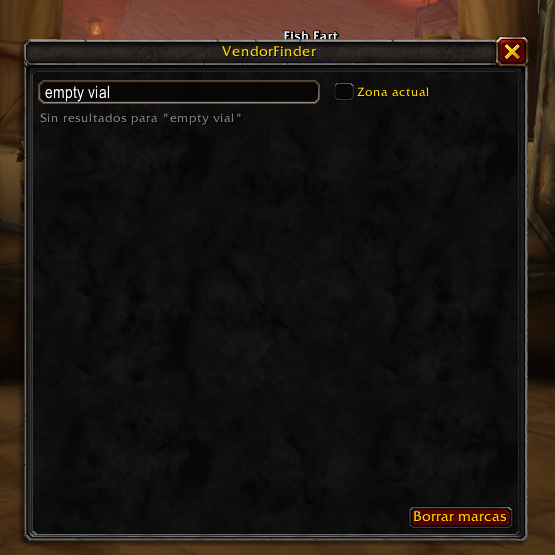

# VendorFinder

Addon para **World of Warcraft: Forever**. Buscás un item, elegís el vendedor y te lo marca en el mapa, en el minimapa y como waypoint (la flecha de supertrack).



## Instalación

Bajá el zip de la [última release](../../releases/latest) y descomprimilo en:

```
World of Warcraft/_forever_/Interface/AddOns/
```

Hay dos zips:

| Zip | Qué trae | Cuándo usarlo |
|---|---|---|
| `VendorFinder-x.y.z.zip` | solo el addon | ya tenés Questie + QuestieDB instalados (desde CurseForge) |
| `VendorFinder-x.y.z-bundle.zip` | addon + Questie + QuestieDB | instalación desde cero |

Después **cerrá y abrí el juego** (WoW solo lee la carpeta de addons al arrancar; `/reload` no alcanza para addons nuevos).

Sin QuestieDB el addon funciona igual, pero solo conoce los vendors que vos mismo hayas abierto.

## Uso

- `/vf` abre la ventana; `/vf empty vial` abre y busca.
- Escribís el nombre (parcial), pegás un link de item o un id.
- Click en un item → lista de vendors ordenados por cercanía.
- Click en un vendor → lo marca en mapa + minimapa y activa el waypoint. Shift+Click agrega sin borrar las marcas anteriores. Click derecho abre el mapa en esa zona.
- "Zona actual" filtra los vendors a la zona donde estás (`/vf zone`).
- "Marcar todos" pinea todos los vendors de la lista.
- `/vf clear` borra marcas · `/vf stats` cuántos vendors escaneaste · `/vf diag` estado de QuestieDB.

Cada mercader que abrís queda registrado (inventario, precio y posición) y esa información pisa a la de QuestieDB para ese NPC, así que el addon mejora solo con el uso y cubre contenido nuevo de Forever que la base todavía no tiene.

## De dónde salen los datos

| Fuente | Qué aporta |
|---|---|
| [QuestieDB](https://github.com/Questie/QuestieDB) (`LibQuestieDB`) | item → vendors, vendor → spawns por zona, facción |
| Escaneo in-game (`Scanner.lua`) | cada mercader que abrís, guardado en `VendorFinderDB` |

QuestieDB guarda spawns por `AreaId` con coordenadas 0–100; el cliente dibuja por `UiMapID` con 0–1. `Zones.lua` hace la conversión con las tablas que publica QuestieDB, o con el `ZoneDB` de Questie si está cargado.

## Estructura

```
VendorFinder/
  VendorFinder.toc
  embeds.xml        LibStub, CallbackHandler-1.0, HereBeDragons-2.0 (+Pins)
  Core.lua          namespace, SavedVariables, eventos, slash commands
  Zones.lua         AreaId <-> UiMapID
  Data.lua          búsqueda de items, vendors por item, distancias
  Scanner.lua       MERCHANT_SHOW -> registra vendor + inventario + posición
  Map.lua           pines HBD, waypoint nativo, TomTom
  UI.lua            ventana
scripts/build_bundle.py   arma los zips (clona Questie/QuestieDB a commits fijos)
.github/workflows/release.yml   publica los zips al pushear un tag vX.Y.Z
```

## Publicar una versión

1. Subir `## Version:` en `VendorFinder/VendorFinder.toc`.
2. `git tag vX.Y.Z && git push --tags`.
3. GitHub Actions arma los dos zips y crea la release.

Para probar el build localmente: `python3 scripts/build_bundle.py` (deja los zips en `dist/`).

## Pendientes

- Botón "¿Dónde lo compro?" en el tooltip del item.
- Exportar/importar `VendorFinderDB` para compartir escaneos.
- Vendors en otro continente: distancia hasta el punto de vuelo más cercano.
- Items con costo extendido (reputación, monedas) se guardan sin precio.

## Licencia

GPL-3.0. Questie y QuestieDB son de [Questie](https://github.com/Questie) (GPL-3.0); el bundle los incluye sin modificaciones de código, recortados a los archivos que carga el cliente de Forever.
